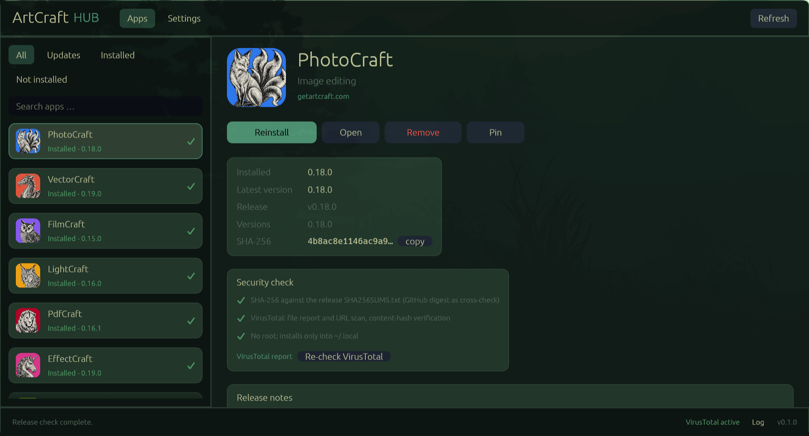

# ArtCraft Hub (Windows)

A native installer and updater for the Craft Apps on Windows –
built for Arch Linux and [Omarchy](https://omarchy.org) under Wayland.

ArtCraft Hub downloads the official `linux-x86_64.tar.gz` packages straight from the GitHub
releases, verifies them against the release's `SHA256SUMS.txt` **and** VirusTotal, installs them
without root into `~/.local`, and creates a menu entry with a high-resolution icon.

It ships three parts:

- **`artcraft-hub`** – a native GUI (Rust + egui/eframe, no Electron, no web view)
- **`artcraftctl`** – a CLI for status, installation, updates and diagnostics
- **`derfleischmann.artcraft`** – an Omarchy bar plugin with an update badge and popup

All user-facing text is in English.

---



## Contents

- [The apps](#the-apps)
- [Security model](#security-model)
- [Requirements](#requirements)
- [Installation](#installation)
- [VirusTotal key setup](#virustotal-key-setup)
- [Usage](#usage)
  - [GUI](#gui)
  - [CLI](#cli)
  - [Omarchy bar plugin](#omarchy-bar-plugin)
- [Data paths](#data-paths)
- [Configuration](#configuration)
- [How it works](#how-it-works)
- [Troubleshooting](#troubleshooting)
- [Development](#development)
- [License](#license)

---

## The apps

| App | Area | Repository |
| --- | --- | --- |
| PhotoCraft | Image editing | `storytold/photocraft` |
| VectorCraft | Vector illustration | `storytold/vectorcraft` |
| FilmCraft | Video editing, colour and sound | `storytold/filmcraft` |
| LightCraft | Photo library and RAW development | `storytold/lightcraft` |
| PdfCraft | Read, organise and protect PDFs | `storytold/pdfcraft` |
| EffectCraft | Motion graphics and VFX | `storytold/effectcraft` |
| DesignCraft | Page layout and publishing | `storytold/designcraft` |
| FigCraft | Interface design and prototyping | `storytold/figcraft` |
| TextureCraft | 3D texture painting | `storytold/texturecraft` |
| MaterialCraft | Procedural materials | `storytold/materialcraft` |
| WordCraft | Word processing and document design | `storytold/wordcraft` |
| SoundCraft | Record, edit and mix audio | `storytold/soundcraft` |
| DeckCraft | Presentations and slideshows | `storytold/deckcraft` |
| CADCraft | CAD and technical drawing | `storytold/cadcraft` |
| GridCraft | Spreadsheets and data analysis | `storytold/gridcraft` |

All 15 supported apps have public releases. An app shows as "no release" only when GitHub's API limit
(60 requests/hour without a token) is reached – the release feed does not include every app,
so there is no fallback in that case. A GitHub token (settings) fixes it.

---

## Security model

Every install and update passes three stages. If any one fails, **nothing is installed**.

1. **Origin** – downloads only from `https://github.com/…/releases/download/…`. Asset names
   must match `<id>-<version>-linux-<arch>.tar.gz`.
2. **Integrity (SHA-256)** – the downloaded file's hash is checked against the release's
   `SHA256SUMS.txt`. The `SHA256SUMS.txt` itself is additionally verified against the digest
   published by the GitHub API (`sha256:…`). If the two sources disagree, the install aborts
   with a hard error.
3. **Malware (VirusTotal)** – the download URL is submitted to VirusTotal for a URL scan. If
   the content is already known as a file there, that entry is used. Installation only happens
   when VirusTotal confirms the **content hash** of the URL response matches the expected
   SHA-256 and **no** engine reports the file as `malicious` or `suspicious`.

### Why a URL scan instead of a file upload?

The release packages are 40–130 MB, but the public VirusTotal API only accepts uploads up to
32 MB. The hub therefore uploads nothing; it hands the GitHub download URL to VirusTotal.
VirusTotal fetches the file itself and computes the SHA-256 of the content. The hub compares
that hash with the expected one, so a redirected or substituted file cannot slip through.

### Transactional installs and rollback

Installs are transactional: a previous version directory is moved aside, the new tree is
activated, and any failure restores the previous version. The hub keeps the active plus
`keep_versions - 1` older versions on disk, so `artcraftctl rollback <id>` (or the GUI button)
can switch back to a previous version without re-downloading; rollback auto-pins that version.
Apps can be pinned (`pin`/`unpin`) to disable automatic updates, and a release can be skipped
(`skip`/`unskip`).

### Optional trust anchors

Beyond checksums, the hub can verify additional anchors (all optional, configurable in
settings; missing anchors are a warning unless the corresponding `require_*` flag is set):

- **Signed `SHA256SUMS.txt`** – a detached `.sig`/`.asc` over the checksum list, verified
  with GPG (optionally against a dedicated keyring and a trusted-fingerprint list).
- **GitHub/Sigstore provenance attestations** – verified with `gh attestation verify`.
- **GPG signature of the archive** – verified when a `.sig`/`.asc` is published next to it.

### Fail-closed

- Without a VirusTotal key, installs and updates are **locked**. The GUI and the bar-plugin popup
  explain this.
- Unknown or not-yet-finished results count as rejection. This can only be overridden deliberately
  via `vt.allow_unknown = true` (`artcraftctl config --allow-unknown true`) – not recommended.
- VirusTotal results are cached per SHA-256 for 7 days. This protects the quota (public API:
  4 requests/minute, 500/day) and makes repeated checks fast.

### What the hub does *not* do

- No root privileges, no writes outside the home directory.
- No background auto-update: installs always start on explicit user action.
- No telemetry. Network access goes only to GitHub, `api.storyteller.ai` (metadata fallback)
  and – with a key configured – `www.virustotal.com`.

---

## Requirements

- Arch Linux or Omarchy (tested with Omarchy 4.0.6, Hyprland 0.56, Wayland)
- Rust 1.85 or newer (`rustup` recommended) – only for building
- `git`, `python3` (used by the install script), optionally `desktop-file-utils` and
  `gtk-update-icon-cache`
- A free [VirusTotal API key](https://www.virustotal.com/gui/my-apikey)

The GUI brings everything it needs for Wayland; no X11 and no web view required.

---

## Installation

```bash
git clone https://github.com/derfleischmann/artcraft-hub.git
cd artcraft-hub
./scripts/install.sh
```

The script builds the workspace in release mode and installs:

| File | Destination |
| --- | --- |
| `artcraft-hub` | `~/.local/bin/artcraft-hub` |
| `artcraftctl` | `~/.local/bin/artcraftctl` |
| Hub icon | `~/.local/share/icons/hicolor/scalable/apps/artcraft-hub.svg` |
| Menu entry | `~/.local/share/applications/artcraft-hub.desktop` |
| Bar plugin | `~/.config/omarchy/plugins/derfleischmann.artcraft/` |

The plugin is then validated and – if `omarchy` is available – activated in the right bar
section. Finally `artcraftctl doctor` runs.

Options:

```bash
./scripts/install.sh --debug        # debug build
./scripts/install.sh --no-plugin    # without the Omarchy plugin
./scripts/install.sh --no-enable    # copy the plugin but do not add it to the bar
```

Uninstall:

```bash
./scripts/uninstall.sh            # only hub, CLI, icon, desktop file and plugin
./scripts/uninstall.sh --apps     # additionally all installed ArtCraft apps
./scripts/uninstall.sh --purge    # additionally configuration, status and caches
```

---

## VirusTotal key setup

```bash
artcraftctl config --set-vt-key <YOUR_KEY>
```

The key is stored in `~/.config/artcraft-hub/config.toml` with mode `0600`. Alternatively it can
be provided via the `VIRUSTOTAL_API_KEY` environment variable; the GUI offers a field under
**Settings**.

Check:

```bash
artcraftctl doctor
```

Doctor reports whether the key is found, whether `~/.local/bin` is on `PATH` and whether the
helper tools are present.

---

## Usage

### GUI

```bash
artcraft-hub
```

Or via the application menu ("ArtCraft Hub"). The UI shows all 15 supported apps with icon, installed
version and the latest available version.

- **Install** – downloads, verifies (SHA-256 + VirusTotal) and installs the current version.
- **Update** – appears once a newer version is available; per app or all at once. An upward arrow
  on the right edge of the row marks an app with a pending update.
- **Remove** – removes the program, symlinks, desktop file and icons of the app.
- **Refresh** – forces a network query instead of the 30-minute cache.
- **Settings** – VirusTotal key, GitHub token, check interval, icon options, language.

- **Filters & search** – filter by All/Updates/Installed/Not installed, search box, keyboard shortcuts (F5 refresh, Ctrl+F search, Ctrl+U updates, 1–4 filters, Esc close).
- **Theme** – follows the active Omarchy theme automatically (configurable).
During a download the GUI shows progress and the current verification stage. Errors are
explained in plain text (missing key, hash conflict, VirusTotal finding, no release, …).

### CLI

```bash
artcraftctl list                 # table of all apps and versions
artcraftctl status               # compact status (cache, ~0 s)
artcraftctl status --refresh     # status with network query
artcraftctl check                # look for updates
artcraftctl install gridcraft    # install one app
artcraftctl install gridcraft --version v0.13.0   # install and pin a specific version
artcraftctl upgrade --all        # update all apps
artcraftctl upgrade photocraft   # update one app
artcraftctl uninstall deckcraft  # remove one app
artcraftctl pin gridcraft        # pin to the current version
artcraftctl unpin gridcraft      # allow updates again
artcraftctl skip gridcraft       # skip the latest release
artcraftctl unskip gridcraft     # stop skipping
artcraftctl rollback gridcraft   # roll back to the previous version
artcraftctl completions bash     # print shell completions
artcraftctl doctor               # check environment and keys
artcraftctl config --show        # show current configuration
```

Useful flags: `--json` for machine-readable output (`list`, `status`, `check`, `doctor`),
`-y/--yes` to skip the confirmation, `--force` to reinstall the latest version,
`--refresh` to ignore the metadata cache.

Example:

```console
$ artcraftctl status
App          Installed    Latest         Status
photocraft   0.16.0       0.17.0         Update available
gridcraft    0.13.0       0.13.0         up to date
vectorcraft  –            0.18.0         not installed
```

### Omarchy bar plugin

The plugin sits in the right bar section (paintbrush icon). It shows a dot and highlight once
updates are available; the tooltip names the count.

| Action | Effect |
| --- | --- |
| Left click | open/close popup |
| Middle click | open popup directly |
| `r` in popup | re-check |
| `o` in popup | start ArtCraft Hub |
| `Enter` in popup | update all |
| click an app name | open the installed app |

The popup lists installed apps with updates, not-installed apps and – if needed – a clear warning
when the VirusTotal key is missing. The upgrade run starts in a floating terminal so progress
and verification results stay visible.

Manual control:

```bash
omarchy plugin list                       # status
omarchy plugin enable derfleischmann.artcraft right
omarchy plugin disable derfleischmann.artcraft
omarchy-shell derfleischmann.artcraft open     # open popup via IPC
omarchy-shell derfleischmann.artcraft close
```

The plugin also lives in the repository under `plugins/derfleischmann.artcraft/`.

---

## Data paths

| Content | Path |
| --- | --- |
| Configuration (0600) | `~/.config/artcraft-hub/config.toml` |
| Status / installed versions | `~/.local/state/artcraft-hub/state.json` |
| VirusTotal cache | `~/.local/state/artcraft-hub/virustotal-cache.json` |
| Downloads, icons | `~/.cache/artcraft-hub/` |
| Installed apps | `~/.local/opt/artcraft/<id>/<version>/` |
| Launchers | `~/.local/bin/<id>` (symlink to the active version) |
| Menu entries of the apps | `~/.local/share/applications/ai.storyteller.<id>.desktop` |
| Icons of the apps | `~/.local/share/icons/hicolor/…/apps/ai.storyteller.<id>.png` |

Several versions of an app can live in parallel under `~/.local/opt/artcraft/<id>/`; the symlink
in `~/.local/bin` points at the active one. Uninstalling removes all versions of the app.

---

## Configuration

`~/.config/artcraft-hub/config.toml` (created with mode `0600` on first save):

| Key | Default | Meaning |
| --- | --- | --- |
| `github_token` | `""` | Optional; raises the GitHub limit from 60 to 5,000 requests/hour |
| `virustotal_api_key` | `""` | Required for installs (or `VIRUSTOTAL_API_KEY`) |
| `metadata_cache_minutes` | `30` | Lifetime of release metadata |
| `check_interval_minutes` | `60` | Recommended check interval for hub and plugin |
| `require_sha256sums` | `true` | Reject releases without `SHA256SUMS.txt` |
| `install_1024_icons` | `true` | Also install the 1024 px PNG from the app repository |
| `language` | `en` | UI language |
| `keep_versions` | `2` | Versions kept per app (active + rollback targets) |
| `parallel_checks` | `4` | Parallel release lookups during status checks |
| `network_retries` | `3` | Network attempts including the first one |
| `follow_omarchy_theme` | `true` | Follow the active Omarchy theme in the GUI |
| `verify_attestations` | `true` | Verify GitHub/Sigstore attestations when present |
| `require_attestations` | `false` | Fail when a release has no attestation |
| `verify_signed_manifest` | `true` | Verify a detached signature over `SHA256SUMS.txt` |
| `require_signed_manifest` | `false` | Fail when `SHA256SUMS.txt` is not signed |
| `require_gpg_signature` | `false` | Fail when an archive has no GPG signature |
| `gpg_keyring` | `""` | Dedicated GPG keyring (empty = default) |
| `gpg_trusted_fingerprints` | `[]` | Trusted signer fingerprints (empty = any valid) |
| `vt.min_interval_seconds` | `16` | Minimum spacing between VirusTotal requests |
| `vt.cache_days` | `7` | Lifetime of a VirusTotal result |
| `vt.poll_seconds` | `20` | Wait between status polls of a URL scan |
| `vt.max_polls` | `15` | Maximum number of status polls |
| `vt.allow_unknown` | `false` | Allow unclear results (**not recommended**) |

The key, the GitHub token and `allow_unknown` can be changed via `artcraftctl config`; everything
else via editor or in the GUI.

---

## How it works

**Release discovery.** Primarily via the GitHub API (`/releases/latest`). As a fallback – for
example when the API quota is exhausted – the hub queries
`https://api.storyteller.ai/v1/craft_apps/release_info` once for all apps. Downloads and
`SHA256SUMS.txt` always come directly from GitHub.

**Installation.** The `tar.gz` is extracted into the cache, every path is checked for traversal
(no absolute paths, no `..`), and the content is moved to
`~/.local/opt/artcraft/<id>/<version>/`. Then symlinks in `~/.local/bin`, the desktop file (with
correct `StartupWMClass` and icon name) and the icons in `hicolor` are created. Finally
`update-desktop-database` and `gtk-update-icon-cache` run so the apps appear in the Omarchy menu
immediately.

**Icons.** Preferably `assets/app-icon/<id>-1024.png` from the respective repository
(1024×1024, RGBA). If missing, the hub falls back to the icons in the tarball. The GUI caches
the PNGs under `~/.cache/artcraft-hub/icons/`.

**Status.** `artcraftctl status` reads the local status and cached metadata, so the call is
essentially free for the bar plugin. `--refresh` or `check` force a network query.

---

## Troubleshooting

**"VirusTotal key missing" / installs locked.**
Configure a key: `artcraftctl config --set-vt-key <KEY>`, then `artcraftctl doctor`.

**"VirusTotal quota exhausted" or HTTP 429.**
The public API allows 4 requests/minute and 500/day. The hub throttles itself to one request
every 16 seconds and caches results for 7 days. When testing frequently, wait or use your own key.

**"Hash mismatch" / hash conflict.**
The file differs from `SHA256SUMS.txt` or from the GitHub asset digest. This can be a broken
download – retry. If it persists, do not install and report the release in the app repository.

**"No release" for FigCraft (or other apps).**
Usually a reached GitHub API limit (60 requests/hour without a token). The release feed does
not contain FigCraft, so there is no fallback. Solution: `artcraftctl config --set-github-token <TOKEN>`
or wait. With a token (5,000 requests/hour) this no longer happens.

**GitHub API limit (HTTP 403).**
Without a token GitHub allows 60 requests/hour. The feed fallback kicks in automatically;
optionally set `artcraftctl config --set-github-token <TOKEN>`.

**App does not appear in the menu.**
Run `update-desktop-database ~/.local/share/applications` and
`gtk-update-icon-cache -f ~/.local/share/icons/hicolor`. Check that `~/.local/bin` is on `PATH`
and that the desktop file exists under `~/.local/share/applications/`.

**Plugin shows "artcraftctl returned no valid response".**
`~/.local/bin/artcraftctl` is missing or not executable. Re-run `./scripts/install.sh` and
verify with `artcraftctl doctor`.

**Plugin not in the bar.**
Check `omarchy plugin list`; activate with
`omarchy plugin enable derfleischmann.artcraft right`. The position can then be moved in
`~/.config/omarchy/shell.json` under `bar.layout.right`.

**Plugin icon is visible but the popup does not react.**
A QML error or a stale compiled plugin can leave the icon in place while the panel fails to
load. Restart the shell with `omarchy-restart-shell` and check
`journalctl --user -n 100 | grep -i artcraft` for `Syntax error` or `ReferenceError`.

**GUI does not start under Wayland.**
Check `WAYLAND_DISPLAY` (`echo $WAYLAND_DISPLAY`). The GUI uses eframe/glow; on systems without
suitable GL drivers try `LIBGL_ALWAYS_SOFTWARE=1 artcraft-hub`.

---

## Development

```bash
cargo build --workspace              # debug
cargo build --workspace --release    # release
cargo test --workspace               # tests (44 in artcraft-core)
cargo clippy --workspace --all-targets
```

Layout:

```
crates/artcraft-core/   catalogue, GitHub, VirusTotal, download, installation, status
crates/artcraft-hub/    GUI (eframe/egui)
crates/artcraftctl/     CLI
plugins/                Omarchy bar plugin (QML)
assets/                 Hub icon
scripts/                install.sh, uninstall.sh
```

The core logic is free of UI dependencies and is shared by GUI and CLI through
`ops::{check_all, install, upgrade_all, uninstall, doctor}`.

---

## License

MIT – see `LICENSE`. Copyright (c) 2026 Joscha Riedl.

ArtCraft itself is a product of Storytold; this project is not
officially affiliated with it and installs only the official release packages.
